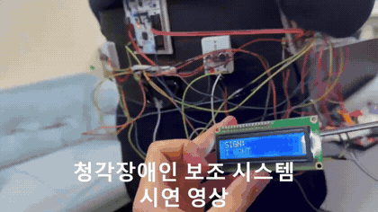

# 음원 방향 추정 · 센서 기반 수어 번역

**STM32 ADC/DMA · TDOA · 센서 특징 분류 · 3보드 통합**

주변 소리의 방향과 수어의 문자 정보를 함께 전달하는 시제품입니다. 세 대의 STM32에서 마이크 처리, 센서 장갑의 동작 분류, LED/LCD 출력을 나누고 SPI로 결과와 모드 설정을 교환했습니다.



[시연영상](media/demo.mp4) · [시연 구간 안내](docs/demo.md) · [시스템 구조](docs/architecture.md) · [개발 과정](docs/development.md) · [결과와 시험 조건](docs/results.md) · [코드 안내](docs/code-map.md) · [실행 준비](docs/reproduction.md)

| 구분 | 내용 |
|---|---|
| 과목 | 임베디드시스템설계 프로젝트2 · 2025학년도 2학기 |
| 하드웨어 | STM32F103RB × 3, 마이크 × 3, Flex 센서 × 5, MPU6050, LED, 16×2 LCD |
| A보드 | ADC scan·DMA, 프레임 에너지·VAD, 교차상관 기반 후방 음원 방향 추정 |
| B보드 | Flex·IMU 취득, 2초 동작 특징, 정수 선형 분류 |
| C보드 | A/B 결과 수신, 방향 LED, 간단어·S/V/O 문장 모드 LCD |

## 센서에서 표시까지

```text
마이크 3개 → A보드 DMA·TDOA ── SPI ──┐
                                     C보드 → 방향 LED / 수어 LCD
Flex 5개 + MPU6050 → B보드 분류 ─ SPI ─┘
                       ↑                 │
                       └── 모드 설정 ────┘
```

## 구현의 핵심

### 데이터 이동과 계산을 분리한 DMA

Timer trigger와 ADC scan·DMA circular 모드로 마이크 데이터를 프레임 버퍼에 모으고, half/full callback으로 처리할 구간을 알립니다. CPU는 완료된 프레임의 에너지·교차상관 계산을 수행합니다. 폴링 방식과 타이머만 동작하는 대조 조건을 분리해 데이터 취득의 병목을 확인한 보고서가 있습니다.

### 방향을 한 프레임에서 끝내지 않기

VAD로 유효한 소리 구간을 고르고 좌우 마이크의 시간차를 계산합니다. 발화가 이어지는 동안 lag histogram과 에너지를 누적해 방향을 정하며, 전후방 에너지와 소음 모드도 판정 조건에 사용합니다.

### 센서 장갑의 특징과 출력 모드를 연결

Flex·IMU의 2초 윈도우에서 185차원 특징을 만들고 다중 클래스 로지스틱 회귀의 가중치를 정수 추론에 연결했습니다. 간단어 모드와 주어→동사→목적어 모드에서 후보 집합을 제한해 LCD에 표시합니다.

## 기록된 결과

보고서에는 방향 LED와 수어 LCD의 통합 시연, DMA/비DMA의 GPIO 구간 계측이 있습니다. 수어 분류의 **약 88%는 PC validation 160개에서 나온 값**이며 STM32에 배포된 모델의 별도 현장 정확도가 아닙니다. 처리 시간의 비교 조건은 [결과 문서](docs/results.md)에 있습니다.

## 코드를 읽는 순서

1. [A보드](firmware/board_a/Core/Src/main.c)에서 ADC/DMA 시작, callback, 프레임 처리와 방향 판정을 봅니다.
2. [B보드](firmware/board_b/Core/Src/main.c)에서 Flex·IMU 취득, 특징 계산과 정수 분류를 봅니다.
3. [실제 학습 코드](tools/train_gesture_all.py)에서 데이터 로드·표준화·`LogisticRegression.fit`을 확인합니다.
4. [C보드 보고서 참조 코드](firmware/board_c/reference_main.c)에서 SPI 두 경로와 LED/LCD 표시 구조를 봅니다.

## 코드와 개발 환경

A/B 펌웨어와 CubeMX 설정, 센서 데이터 수집·실제 모델 학습 도구를 제공합니다. C의 SPI·LED·LCD 동작은 보고서 부록에서 복원한 참조 코드로 볼 수 있습니다. 파일별 출처와 설정·입력 형식은 [코드 안내](docs/code-map.md)와 [실행 준비](docs/reproduction.md)에 정리했습니다.

---

[임베디드1: 음성 조명 제어](https://github.com/jounget5411-lab/embedded-voice-lighting-portfolio) · [임베디드3: 사진 판별·선별 저장](https://github.com/jounget5411-lab/embedded-intrusion-detection-portfolio)
