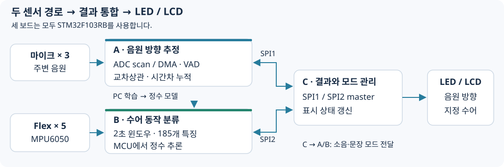

# 음원 방향과 수어를 함께 전달하는 장치

마이크로 주변 소리의 방향을 추정하고, 센서 장갑의 동작을 문자로 표시하는 시제품입니다. 세 대의 STM32에서 두 입력 경로와 출력 처리를 나누고 SPI로 결과와 모드 설정을 교환했습니다.

**STM32F103RB · C/HAL · ADC/DMA · TDOA · Flex/IMU · 정수 추론 · SPI · LCD**

## 전체 흐름

A보드는 마이크, B보드는 Flex 센서와 MPU6050을 처리합니다. C보드는 결과를 읽어 방향 LED와 16×2 LCD를 갱신합니다. 수어 모델은 PC에서 학습하고, B보드에서는 정수 파라미터로 추론합니다.

## 시연

[전체 시연영상](media/demo.mp4) · [확인할 구간](docs/demo.md)

음원 방향에 따른 LED와 손동작에 따른 LCD 출력을 확인할 수 있습니다. 수어 입력은 지정된 표현을 사용하는 간단어 모드와 주어→동사→목적어 모드로 구성했습니다.

## 주요 구현

**1. DMA 기반 마이크 데이터 취득**

Timer trigger→ADC scan→DMA circular buffer로 데이터를 모읍니다. half/full callback은 처리할 구간을 알리고, CPU는 완료된 프레임의 에너지·교차상관을 계산합니다. 여러 ADC 채널은 순차 변환합니다.

**2. 발화 구간을 누적하는 방향 판정**

VAD로 유효한 소리를 고르고 좌우 마이크의 시간차를 계산합니다. 한 프레임의 결과에 의존하지 않도록 발화 동안 lag histogram과 에너지를 누적하고, 전후방 에너지와 소음 모드도 판정 조건에 사용합니다.

**3. 센서 특징과 표시 상태의 연결**

Flex·IMU의 2초 윈도우에서 185차원 특징을 생성합니다. 다중 클래스 로지스틱 회귀를 정수 점수 계산으로 배포하고, 모드·문장 단계에 맞는 후보를 골라 LCD에 표시합니다.

## 결과와 확인 범위

보고서에 방향 LED·수어 LCD 통합 시연과 DMA/비DMA의 GPIO 구간 계측이 기록되어 있습니다. **약 88%는 PC validation 160개의 수어 분류 결과**이며, STM32 배포 모델의 현장 정확도와 구분합니다. 비교 조건은 [결과 문서](docs/results.md)에 있습니다.

A/B 펌웨어와 CubeMX 설정, 수집·학습 도구를 제공합니다. C보드는 보고서 부록에서 복원한 참조 코드이며, 독립 빌드에 필요한 프로젝트 설정은 완비되지 않았습니다. 출처와 데이터 준비 조건은 아래 문서에서 확인할 수 있습니다.

## 문서와 코드

| 살펴볼 내용 | 링크 |
|---|---|
| 보드 경계·모드·데이터 흐름 | [시스템 구조](docs/architecture.md) |
| 설계 선택과 문제 해결 | [개발 과정](docs/development.md) |
| 시험 조건·계측·재현 범위 | [결과](docs/results.md) · [실행 준비](docs/reproduction.md) |
| 원본 파일·부록 복원·학습 입력 | [코드 안내](docs/code-map.md) |
| DMA·교차상관·방향 판정 | [A보드 코드](firmware/board_a/Core/Src/main.c) |
| 센서 취득·특징·정수 분류 | [B보드 코드](firmware/board_b/Core/Src/main.c) |
| 두 SPI 경로·LED/LCD | [C보드 참조 코드](firmware/board_c/reference_main.c) |
| 표준화·모델 학습 | [PC 학습 도구](tools/train_gesture_all.py) |

---

[대표 프로젝트 모아보기](https://github.com/jounget5411-lab/portfolio)
